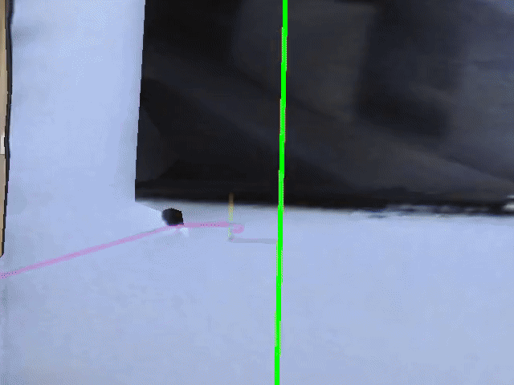

# Continuous Demo Replay Package

This folder packages the local code and assets needed to replay the bundled Habitat human demonstration without depending on the rest of this repository's Python files.

## Demo Video

[](demo.mp4)

GitHub does not inline local `.mp4` files in README rendering, so this preview uses `demo.gif` and links to the full `demo.mp4`.

Included files:

- `scripts/replay_human_demo.py`
- `src/continuous_demos/sim.py`
- `src/continuous_demos/pure_pursuit.py`
- `examples/17DRP5sb8fy.json.gz`
- `demo.gif`
- `src/continuous_demos/assets/tidybot_description/urdf/tidybot_base_minimal.urdf`
- `src/continuous_demos/assets/tidybot_description/meshes/base/tidybot++/Kinova.stl`

Not included:

- Habitat / Habitat-Sim libraries
- Matterport3D scene assets
- other repository files that are not required for this replay flow

## Requirements

You need a Python environment that already has the runtime dependencies installed, including:

- `habitat_sim`
- `magnum`
- `numpy`
- `imageio`

You also need the Matterport3D scene data already installed somewhere on disk.

## Scene Root Resolution

`replay_human_demo.py` resolves relative scene paths in this order if `--scene-root` is not provided:

1. `HABITAT_SCENE_ROOT`
2. `./data/scene_datasets`
3. `../data/scene_datasets`

That means this packaged folder works directly in its current location under the Habitat repo, and it can also be moved elsewhere if you either:

- set `HABITAT_SCENE_ROOT`, or
- pass `--scene-root /path/to/data/scene_datasets`

## Example Commands

Run from this folder:

```bash
python scripts/replay_human_demo.py examples/17DRP5sb8fy.json.gz --episode-index 4 --output demo.mp4 --debug-draw
```

If your MP3D scenes live outside the parent repo layout, pass the scene root explicitly:

```bash
python scripts/replay_human_demo.py examples/17DRP5sb8fy.json.gz --episode-index 4 --scene-root /path/to/data/scene_datasets --output demo.mp4 --debug-draw
```

The script prints the episode goal category and episode info before following the demonstration path.
